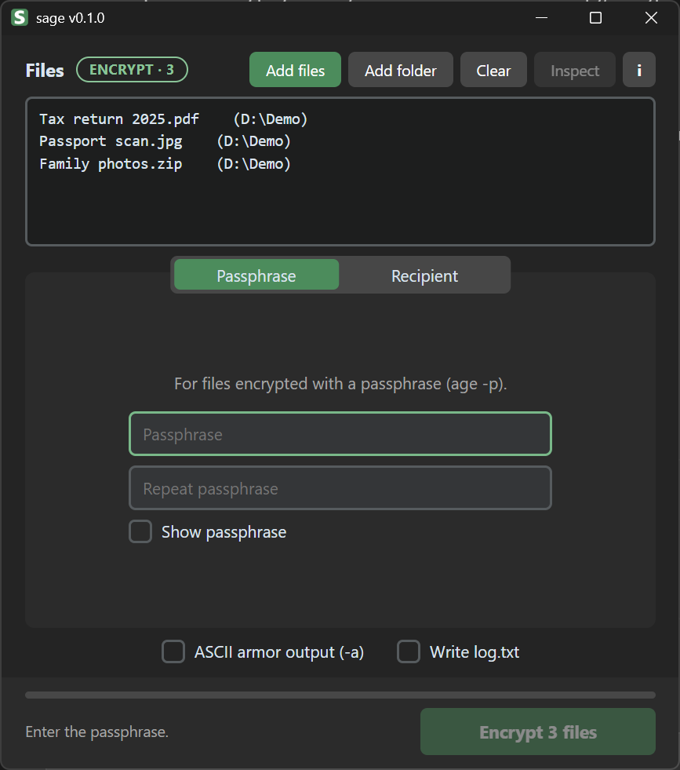
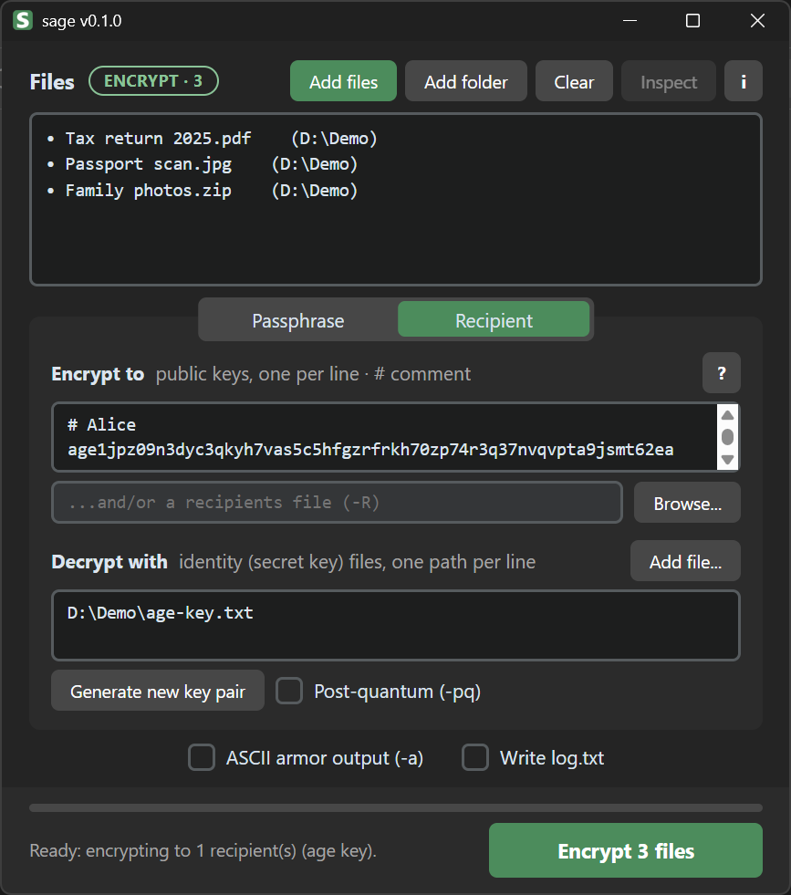

<p align="center">
  
</p>

# sage

**sage** = **S**imple GUI for **age**: a small Windows app for encrypting and decrypting files with [age](https://age-encryption.org), the simple, modern file encryption format.

- **Portable: one exe, nothing to install.** Copy `sage.exe` anywhere (a USB stick works) and run it. The official age library ([filippo.io/age](https://github.com/FiloSottile/age)) is built in, so sage doesn't call `age.exe` and needs no plugins.
- **For Windows 10 and 11, x64 (amd64) and ARM64.** Download the zip for your PC from [Releases](https://github.com/t0ma5/sage/releases). Not sure which? Settings > System > About > System type.
- **Drop files, type a passphrase or pick keys, done.** Output goes next to each file and never overwrites an existing one.
- **Compatible with age.** Files sage encrypts open with the `age` command-line tool and any other age implementation, and the other way round (checked by the test suite against `age.exe`).

sage is unofficial and not affiliated with age's authors.

<p align="center">
  
  
</p>

## Use it

1. Start `sage.exe`.
2. Add files: drop files or folders on the file list, or use **Add files** / **Add folder**. Each addition joins the list; duplicates are skipped. A folder adds the files directly inside it (the list says how many subfolders were left out).
3. Choose a tab, **Passphrase** or **Recipient**, and fill it in.
4. Click the button at the bottom right (**Encrypt 3 files**, **Decrypt 1 file**, ...) or press Enter in a passphrase field.

The line next to the button always says what is missing ("Repeat the passphrase to confirm it.", "Add an identity file under 'Decrypt with'.") and, after a run, the result ("Finished: 3 OK, 0 failed").

**Encrypt or decrypt is chosen by the files:** `.age` files are decrypted, everything else is encrypted. If you add both kinds, only the `.age` files are kept.

### Passphrase

For files protected with a passphrase (`age -p`). Encrypting asks for it twice; **Show passphrase** reveals it. A passphrase containing a line break (usually from pasting) is refused. A wrong passphrase on the first file stops the batch, because every further file would fail the same way after another slow key derivation; files that failed or weren't processed stay in the list for a retry.

### Recipient (keys)

- **Encrypt to:** public keys, one per line: age keys (`age1...`), post-quantum age keys (`age1pq1...`), tagged keys, or SSH keys (`ssh-ed25519 ...`, `ssh-rsa ...`). `#` starts a comment. And/or a recipients file. Everyone listed can decrypt the file.
- **Decrypt with:** identity (secret key) files, one path per line: age identity files or unencrypted SSH private keys.
- **Generate new key pair** writes a new identity file (classic or **post-quantum**) to a folder you choose, as `age-key.txt` or `age-key (1).txt`, and adds it to the boxes. Keep that file secret and backed up: without it, files encrypted to its public key can't be decrypted.

Encryption is blocked, with the reason, instead of producing a file someone can't open: a line that isn't a usable key (with its line number), a missing recipients file, a secret key pasted where a public key belongs, an SSH key type age can't encrypt to, or post-quantum and classic keys mixed in one file (age refuses that: the classic key would make the file breakable by a quantum computer).

Not supported yet: age plugins (e.g. YubiKey), and passphrase-protected identity files or SSH keys.

### Output

- Encrypt adds `.age`, decrypt removes it. **Existing files are never overwritten:** a taken name becomes `name (1).ext` (`archive (1).tar.gz`, `.gitignore (1)`).
- Each file is written as `name.part` first and renamed only when it finished correctly. A failed or cancelled file leaves nothing behind; a crash leaves an obvious `.part` file, never a truncated file under the real name.
- Works on virtual drives such as a mounted Cryptomator vault, and in folders with paths over 260 characters.
- **Cancel** stops the current file and removes its partial output. **Inspect** shows what an `.age` file is encrypted to and whether it is post-quantum, without decrypting it.
- The **i** button shows the version and links to this repository and to age.

### Options and settings

- **ASCII armor output (-a):** text output instead of binary, for e-mail or chat.
- **Write log.txt** (off by default): a timestamped log next to `sage.exe`. It never contains the passphrase, but it does list which files you processed.
- Settings are saved in `sageSettings.json` next to `sage.exe`. Only recipients, comments and paths are stored; secret keys, pasted private keys and other stray text never are. A damaged settings file is kept as `sageSettings.json.bad` and reported.

### Send to

sage opens with any files passed on its command line, so it works from Explorer's **Send to** menu: press `Win+R`, type `shell:sendto`, and put a shortcut to `sage.exe` in the folder that opens.

## Build from source

Requirements: [Go](https://go.dev) 1.26+, [Node.js](https://nodejs.org), and the Wails v3 CLI:

```text
go install github.com/wailsapp/wails/v3/cmd/wails3@v3.1.0
```

Build (the exe lands in `bin\sage.exe`):

```text
wails3 task windows:build ARCH=arm64
wails3 task windows:build ARCH=amd64
```

`ARCH` defaults to the Go toolchain's own architecture. sage is pure Go (no cgo), so both architectures build from either machine. It uses the WebView2 runtime that is part of Windows 10 and 11.

## Releases

Releases are built by GitHub Actions (`.github/workflows/release.yml`) when a version tag is pushed (`git tag v0.1.0`, `git push origin v0.1.0`). It builds both architectures on one Windows runner, runs the tests (including interop with the official `age.exe`, checksum pinned), and attaches `sage-<version>-windows-amd64.zip`, `...-arm64.zip` and `SHA256SUMS.txt` to a **draft** release for you to review and publish. Each zip carries a build provenance attestation: `gh attestation verify <zip> --repo t0ma5/sage`. The tag must match `appTitle` in `service.go`.

## Tests

```text
go test ./...
```

The tests cover passphrase and key round trips, armor, SSH keys, output naming and the never-overwrite rule, cleanup after wrong passphrases, cancels and damaged input, long paths, recipient and settings checks, and the batch runner. The interop tests encrypt with sage and decrypt with the official `age.exe` and vice versa; they use `age.exe` from PATH, or point `SAGE_TEST_AGE` at one (and keep `age-plugin-batchpass.exe` next to it). They are skipped when it is missing, unless `SAGE_REQUIRE_INTEROP=1` is set.

## Project layout

| Path | What |
| --- | --- |
| `core.go` | Encryption core: key parsing (mirrors the age CLI), output naming, `.part` files, one file at a time. No GUI code. |
| `service.go` | What the window calls: status and hints, the batch runner, settings, dialogs, key generation, Inspect. |
| `main.go` | Window and app setup. |
| `rename_windows.go` | Rename that never replaces a file, with long-path support. |
| `frontend/` | The window: `index.html`, `src/main.ts`, `src/style.css`. |
| `*_test.go` | Tests. |

## Credits

- [age](https://age-encryption.org) by Filippo Valsorda and Ben Cartwright-Cox; sage uses its Go library, [filippo.io/age](https://github.com/FiloSottile/age) (BSD-3-Clause).
- [Wails](https://wails.io) for the window.
- Cover photo by Paulina S. on [Unsplash](https://unsplash.com/photos/green-leaves-on-white-surface-fPyE0Xl-C2g).

## License

BSD-3-Clause, see [LICENSE](LICENSE). The release zips also contain `THIRD_PARTY_LICENSES.txt` with the licences of the Go standard library and the modules built into `sage.exe` (age, Wails, ...).
